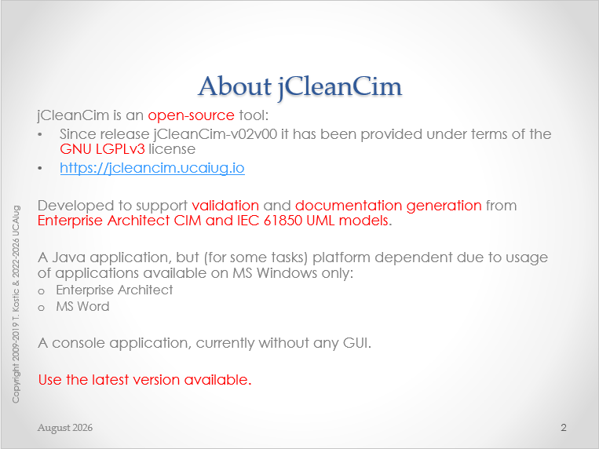

# jCleanCim

**jCleanCim** is an open source tool for validation and documentation generation from [Enterprise Architect](https://sparxsystems.com/products/ea) UML models of IEC TC57 CIM and IEC61850 UML models.

Up until the end of 2015 it had been hosted by the [CIM Methods & Tools for Enterprise Integration group](https://ucaiug.org/) on the CIM Users Group web site, with access limited to the CIM and IEC61850 users community members only. To make it accessible to non-CIMug members, in 2016 it was transitioned to a fully open source tool and hosted at [Tanja Kostic's website](https://www.tanjakostic.org/jcleancim). 

In November of 2022, with Tanja Kostic's approval, jCleanCim was officially migrated here as part of the CIMug's Open Source Initiatives effort.

jCleanCim is a console (non-GUI) Java application, and its Java code is platform independent. It must nevertheless run on MS Windows, because it uses the Enterprise Architect and MS Word automation libraries (.dll files).

*   [Latest Release](#latest-release)
*   [Introduction to jCleanCim](#introduction-to-jcleancim)
*   [Documentation](#documentation)
*   [Distributions and prerequisites](#distributions-and-prerequisites)
    *   [Java runtime requirements](#java-runtime-requirements)
    *   [Binary distribution](#binary-distribution)
    *   [Source distribution](#source-distribution)
*   [Dependencies](#dependencies)
*   [Performance indicators](#performance-indicators)
*   [Hints (read before reporting a problem)](#hints)
*   [Configuration documentation](#configuration-documentation)
*   [Disclaimer](#disclaimer)
*   [What's new in this release](ReleaseNotes.md#release-notes-for-jcleancim-240) 

The full history is in the [release notes](ReleaseNotes.md).

## Latest Release

  -   2.4.0 (released 10-Aug-2026)

      - The latest release is available on GitHub at [jCleanCim-2.4.0](https://github.com/cimug-org/jCleanCim/releases/tag/2.4.0) and is delivered as two ZIP files (binary and source).
      - Information on features and fixes for the release can be found in the [release notes](ReleaseNotes.md).

## Introduction to jCleanCim

The "Introduction to jCleanCim" presentation gives an overview of the tool. It is available in PDF and PowerPoint formats.

## Documentation
Each unzipped jCleanCim distribution contains the full documentation in its `doc` directory. The main parts of the source code are documented, and that documentation is generated as _javadoc_: a set of linked web pages.

*   Each distribution contains an up-to-date set of slides, `doc/jCleanCimIntro.pptx` (`doc/jCleanCimIntro.pdf`), which is the recommended starting point.
*   Each distribution contains the javadoc in `doc/api/index.html`. The documentation of the root package `org.tanjakostic.jcleancim` (Description section) is a good starting point.
*   Source distribution contains the PDF version of the dependency graph of the Apache ant build targets (this is useful for a developer only).
*   Each distribution also contains the report of the tests run during its build, under `doc/testReport/index.html`. It is mainly of interest to developers.

## Distributions and prerequisites

jCleanCim 2.4.0 ships as two distributions: **binary** and **source**. That is the
only distribution split — there is no separate 32-bit or 64-bit download. Both
require Java 17 or later; which *bitness* of Java you install depends on the
Enterprise Architect project file you are reading.

### Java runtime requirements

Support for Java 17+ was introduced in jCleanCim 2.4.0.

| Your EA project file | Enterprise Architect | Binary distribution needs | Source distribution needs |
|---|---|---|---|
| `.eap(x)` | 15.x and earlier (32-bit) | 32- **or** 64-bit Java 17+ JRE | 32- **or** 64-bit Java 17+ JDK |
| `.qea(x)` | 16.0+ (64-bit) | 64-bit Java 17+ JRE **only** | 64-bit Java 17+ JDK **only** |

**A 64-bit Java installation is recommended.** It generates documentation from both
`.eap(x)` and `.qea(x)` project files, so it is the only choice that works across
every project you are likely to encounter.

> **On 32-bit Java availability.** If you specifically need a 32-bit runtime for the
> legacy `.eap(x)` path, note that most current OpenJDK vendors have wound down 32-bit
> Windows builds: [Eclipse Temurin](https://adoptium.net/temurin/releases) publishes
> x86-32 Windows binaries through JDK 17 but not for JDK 21 or later. This constrains a
> 32-bit installation to the JDK 17 line, which satisfies jCleanCim's Java 17+ floor.
> It is another reason to prefer 64-bit where your EA version allows.

To verify what you already have, open the console window and type `java -version`
(runtime) or `javac -version` (development kit).

### Binary distribution

Archive: `jCleanCim-[version]-bin.zip`

**Intended use.** Run jCleanCim from the console (cmd.exe). For the jCleanCim end-user.

**Prerequisites**

- A **Java 17+ JRE**, at the bitness required by your project file — see
  [Java runtime requirements](#java-runtime-requirements) above.
- [Enterprise Architect](https://sparxsystems.com/products/ea/), at the version
  matching your project file format (see the same table).
- (optional: to run doc generation) [MS Word](https://www.microsoft.com/en-us/microsoft-365/word)

**Installing**

Unzip the distribution anywhere on your file system; it will uncompress into its own
directory tagged with the version, so there is no danger of overwriting an older
installation. Any archive tool will do — right-click the .zip in Windows Explorer and
choose "Extract All", or use the equivalent command in 7-Zip or WinZip.

### Source distribution

Archive: `jCleanCim-[version]-src.zip`

**Intended use.** Run jCleanCim from the console (cmd.exe) or from within Eclipse.
Develop and build it with Apache Ant or with Eclipse. For the jCleanCim developer,
packager, and end-user.

**Prerequisites — required**

- A **Java 17+ JDK**, at the bitness required by your project file — see
  [Java runtime requirements](#java-runtime-requirements) above. A JRE is not
  sufficient: building from source requires a development kit.
- Something to compile the code and create an executable, for example:
  - Apache [Ant](https://ant.apache.org/bindownload.cgi) 1.8.0 or later. To verify whether you already
    have it installed, open the console window and type `ant -version`.
  - or an IDE if you are already a Java developer.
- [Enterprise Architect](https://sparxsystems.com/products/ea/), at the version
  matching your project file format.

If you are already developing in Java with Eclipse, you have what you need. If your
only Eclipse is the runtime bundled with CIMTool, that is **not** sufficient — it is a
runtime without Java code development support. On the Eclipse download site, the
minimum required distribution is "Eclipse IDE for Java Developers"; you can then
install the CIMTool plug-in into that (or a more recent) Eclipse.

**Prerequisites — optional, at runtime**

- (to run doc generation) [MS Word](https://www.microsoft.com/en-us/microsoft-365/word)

**Prerequisites — optional, during the Ant build**

- [Graphviz](https://graphviz.org/download/), used to render the Ant build target
  dependency graph as a PDF for the source distribution. To verify whether you already
  have it installed, open the console window and type `dot -V`. If Graphviz is not
  installed, the target that depends on it is skipped and the rest of the build is
  unaffected; only that one diagram is missing. The exception is `ant dist-src`, which
  stops rather than produce a source distribution without the diagram (see the note
  below).

Graphviz is the only external install needed for the build. The other build-time
tools — JUnit 4 and Grand — are bundled in the source
distribution's `lib` directory and require no separate download; see
[Dependencies](#dependencies).

**Installing**

Same as for the binary distribution (`jCleanCim-[version]-bin.zip`).

The source distribution contains the Eclipse project files. To use it with Eclipse,
then after unzipping, start Eclipse and use Import -> Existing project and browse to
the unzipped directory.

Note: This is the most flexible option if you are developing, as you can have the
Eclipse project anywhere on your disk (not necessarily in an Eclipse workspace).

_Note for source distribution (and if you need to create the distribution yourself)_: the Ant build file contains a target that invokes the GraphViz application to render the build target dependency graph as a PDF. If you do not have GraphViz installed on your local system, that target is skipped during an ordinary build. Producing the source distribution (`ant dist-src`, also run by `ant all`) is different: it stops with an error rather than silently ship a distribution without the diagram. Either install GraphViz and re-run, or run `ant dist-src -Dallow.incomplete.dist=true` to build the source distribution without it.

## Dependencies
To be self-contained, jCleanCim distributions bundle relevant third party open source/distributable libraries. Java jars are in the project's `lib` directory, and MS Windows dlls are in the `dlls` directory.

The following libraries are packaged with all the distributions of jCleanCim:

*   For access to EA model file:
    *   When images or XMI must be exported, jCleanCim uses the EA Java API, which depends on an MS Windows dll. By working directly with EA model file, jCleanCim tries to identify problems at the source (the `.eap(x)` or `.qea(x)` project file), before any XMI or other artefact generation takes place.
    *   When no images or XMI are exported, jCleanCim reads the EA project file directly as a database, which is OS independent. Which library is used depends on the project file format:
        *   `.eap`/`.eapx` files are MS Access databases, read with the [Jackcess](https://jackcess.sourceforge.io/) library.
        *   `.qea`/`.qeax` files are SQLite databases, read with the [SQLite JDBC driver](https://github.com/xerial/sqlite-jdbc). This was added in release 2.4.0 alongside Jackcess — it does not replace it, since both project file formats remain supported.
*   For document generation, jCleanCim uses the [Jacob](https://sourceforge.net/projects/jacob-project/files/) library, which gives Java access to the MS Word automation interface through an MS Windows dll. Since release 2.4.0 both 32-bit and 64-bit dlls are distributed, and the matching one is selected for the Java installation you run. MS Word itself is not distributed; jCleanCim uses the installation on the local machine.
*   For logging, jCleanCim uses Apache [log4j](https://logging.apache.org/log4j/).
*   For command-line processing, jCleanCim uses Apache [Commons CLI](https://commons.apache.org/proper/commons-cli/).
*   For string markup processing and some stopwatch functionality, jCleanCim uses Apache [Commons Lang](https://commons.apache.org/proper/commons-lang/). The 2.x line (`commons-lang-2.6.jar`) is bundled; Jackcess also depends on it.
*   Apache [Commons Logging](https://commons.apache.org/proper/commons-logging/) is bundled as a transitive dependency of the libraries above; it is not used directly from the jCleanCim source code.
*   For the logging facade required by the SQLite JDBC driver, the distributions bundle [SLF4J](https://www.slf4j.org/) (API only).
*   For reading and writing OpenXML (`.docx`) documents, the distributions bundle Apache [POI](https://poi.apache.org/) (`poi-ooxml`).

The following libraries are packaged only with source distribution of jCleanCim:

*   For unit testing, jCleanCim uses [JUnit 4](https://junit.org/junit4/). It is needed only to run or develop tests, or to produce distributions (which run the tests and include their report).
*   For the Ant target dependency graph, the build uses the [Grand](https://ant-grand.github.io/Grand/grand.html) library together with [GraphViz](https://graphviz.org/download/); without GraphViz the graph is skipped in ordinary builds, and `ant dist-src` stops unless run with `-Dallow.incomplete.dist=true`. These are not used from the jCleanCim source code.
*   [UmlGraph](https://www.spinellis.gr/umlgraph/) (`UmlGraph.jar`) is still included, but as of release 2.4.0 the build no longer uses it: UmlGraph 5.6.6 is built against the javadoc doclet API that JDK 13 removed, so UML class diagrams are no longer embedded in the javadoc. Its configuration is kept, commented out, in `build.xml` until a JDK 17-capable UmlGraph is adopted.
*   PDF generation from the javadoc previously used the PDFDoclet application. It was built against the pre-JDK-9 doclet API, which JDK 13 removed, and the project is unmaintained; as of release 2.4.0 the PDF javadoc is no longer produced or distributed. The `pdfdoclet-1.0.2-all.jar` file is still included but is not used by the build.

## Performance indicators

Since **jCleanCim** talks to EA and to MS Word through their automation APIs, the model building (as a first step in the application) and the MS Word document generation (if enabled) take time:

*   The EA automation API has no bulk read operations: every _single_ item returned through the API costs one SQL query on the underlying database (MS Access for `.eap(x)`, SQLite for `.qea(x)`), even for items in a collection. Performance is therefore determined by the number of elements (classes, attributes, and so on) and the number of diagrams saved to file. Release 1.7.0 provided a new implementation for reading the UML model from EA (option `model.useSql = true`, in that release only). **Since release 1.8.0**, a further implementation is available (see [Fast loading of .eap file](ReleaseNotes.md)) and the `model.useSql` boolean option is replaced by an option that takes one of three predefined string values. **_In short: to export XMI for a model release, or diagrams for document generation, use `model.builder=sqlxml`; otherwise leave the option empty or set `model.builder=db`. See also [hint on fixing ordering errors](#hints)_** .
*   MS Word is very slow at inserting captions for figures and especially for tables, and at populating and formatting tables. As the number of figures and tables grows, each new caption takes longer, because MS Word renumbers all captions (the same happens when captions are inserted by hand). This automatic numbering cannot be disabled when the document needs tables of figures or tables. **Since release 1.5.0, the configuration option `docgen.saveReopenEvery` speeds up MS Word document generation and is strongly recommended.** The default value is 12; a higher value may be faster for a given document, so it is worth testing. See also [discussion on this option](ReleaseNotes.md) and its resulting performance improvement.

Java processing (validation, statistics, collecting documentation from the in-memory model for the writers, and XML generation for web access) takes a few seconds for all the models and scenarios tested.

## Hints
The following known limitations (not planned to be addressed soon) and performance advice apply when running jCleanCim:

* **To validate the model only, or to generate XML or Word documents without diagrams, use `model.builder=db`, the fastest option; this builder cannot export diagrams.** With any other builder option, and when `docgen.on=true`, diagrams get exported from the EA model (in order to be used in the generated doc), while with `docgen.on=false` (or empty, or absent) document generation is disabled and no diagrams are exported. Skipping diagram export saves 300–500 ms per normative diagram: at least half a minute for a model with 100 normative diagrams.

* 	EA ordering errors. (since 1.8.0) In the initial, model building phase, you may see logged ERROR (+++ EA ordering error) for several UML elements (diagrams, packages, classes, etc.). EA's internal storage does not always keep the order of items in a container up to date. Through the API (very slow), jCleanCim follows the order returned by EA. When processing SQL query results (faster) or reading the tables directly (fastest), those position indices may be uninitialised, as stored in the repository. To fix the order, open the model in EA and move an item in the indicated list up and then down again; this triggers EA's internal update, and the error no longer appears on the next run.

* 	When `model.builder=japi` is still used for reading the EA file:
    *   Remove any baselines. They increase the data in the underlying RDBMS, and every SQL query that EA performs (one for each single attribute, association, class, package, tagged value, constraint and dependency) takes longer on a larger dataset.
    *   Compact the EAP file regularly with Tools - Manage .EAP file - Compact .EAP file. This has no effect when run from an EA session that has the same model open (which is also why it cannot be done programmatically): open EA with a different model, or with no model, then select the file to compact.
  
* When running MS Word document generation:
    *   [since 1.8.0] If you can, save your template as native Office 2007+ document (.docx), without compatibility enabled. This will run much faster, because in this case only, it is possible to programmatically disable field updates.
    *   Document generation is supported only on an English version of MS Office. _Reason_: the generated MS Word documents are primarily for the IEC and must be in English, and an implementation that is portable across language versions of MS Word has not proved feasible.
    *   Note that caption labels and styles are notoriously non-portable among installations of MS Word (same user - 2 computers; different users on the same computer; different installation languages). Caption labels are said to be contained in the user's Normal.dotm template, see [here](https://answers.microsoft.com/en-us/office/forum/office_2007-word/new-caption-label-doesnt-display-in-new-version-of/18b9408d-148f-4c76-8d92-917c875406d8), but not really so, see [here](https://www.msofficeforums.com/word/15715-captions-self-defined.html). MS Word can also change these settings on its own, affecting the global template or the registry (and so every document edited afterwards) without any visible sign. For a case where the caption language changes, see [Word is in English but "Figure", "Equation" and "Table" appear in Spanish](https://superuser.com/questions/55311/microsoft-word-is-in-english-but-figure-equation-and-table-appear-in-span#55326). jCleanCim deliberately does not modify any user-specific MS Word installation. Any missing items that should appear in the output, such as English caption labels on a German MS Word, must be added to the Word installation by the user.

**Contributions of a portable solution that does not modify the user's registry are welcome; please submit the code with test cases as a [GitHub issue or pull request](https://github.com/cimug-org/jCleanCim/issues) for integration into the baseline. Until then, on a non-English installation of MS Word, add the English custom caption labels Figure and Table. If jCleanCim fails on a non-English installation of MS Word, the most likely cause is that these English caption labels have not been defined.**

*   Be sure to update all fields in the MS Word template before starting document generation **_with change tracking turned OFF_** , in particular if you have added/removed tables/figures and their captions. MS Word is known to corrupt caption numbers (identifiers) when they are edited with change tracking enabled.
    *   Disable automatic spell checking in the styles 'PARAGRAPH', 'TABLE-cell' and 'Normal'.
    *   \[old\] On a Windows 7 development machine, some diagram formatting (with resizing or similar) caused the PrintSpooler process (the Windows printing service) to start immediately after the EA repository was opened. This appeared when building the Domain package of the sample EA repository, which then seemed never to finish. Stopping the PrintSpooler service at that point (Computer/Manage/Services and Applications/Services/PrintSpooler/Stop) produced about 20 pop-ups from EA reporting a font problem, which indicates an interaction between EA and the operating system. If this occurs, temporarily stop the PrintSpooler service while running jCleanCim. The behaviour was observed only on Windows 7, never on Windows XP.

## Configuration documentation
For an overview of all configuration options, unpack a release into your local directory and open `doc/api/org/tanjakostic/jcleancim/common/Config.html`. You can reach the same page from `doc/api/index.html` by selecting the class `Config` from the class list. The javadoc is generated at build time and ships inside each distribution, so it is not part of this site.

## Disclaimer
Starting with release 2.0.0, jCleanCim has been licensed under the terms of GNU LGPLv3 [license](LICENSE) and includes a modified [copyright](copyright.md). The copyright as well as a reference to the license for this software is available at the download site, and is included in every distribution and in every java source file.

An accessible comparison of open-source licenses is available at [choosealicense.com](https://choosealicense.com/licenses/#lgpl-v3).

* * *

[Copyright](copyright.md) [License](LICENSE)

[Feedback](https://github.com/cimug-org/jCleanCim/issues)

